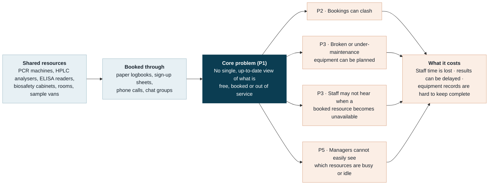

# Resource Reservation Management System

**Shared resource reservation in medical laboratories** · PrimeWave Lab (Pvt) Ltd, Software Engineering Internship technical assessment

**Stack:** Next.js (App Router) · TypeScript · PostgreSQL

**Project documents:** [Problem statement, version 1.0 (PDF)](docs/problem-statement.pdf) · ER diagram: _dbdiagram.io link (add when published)_

---

## 1. Problem statement

> Medical laboratories share a limited set of instruments, biosafety cabinets, rooms and, in lab networks, sample-transport vehicles among many staff and sections. When their use is coordinated through paper logbooks, sign-up sheets, phone calls and chat groups, nobody has one up-to-date view of what is free, what is booked and what is out of service. As a result, bookings can clash, work can be planned on equipment that is broken or due for maintenance, staff may not be told when a booked resource becomes unavailable, and managers cannot easily see which resources are overloaded and which sit idle. This costs staff time, can delay test results and makes complete equipment records hard to keep, at a time when labs face rising workloads, staff shortages and tight budgets [4, 8, 9].

**Our question:** How can we give every lab staff member one trustworthy, live view of shared resources, so that bookings never clash, unusable equipment is never booked, and managers can see how resources are really used?

**Our answer:** a web-based Resource Reservation Management System that gives all lab staff one live schedule, makes clashing bookings impossible, keeps broken and under-maintenance equipment off the schedule, and shows managers how each resource is used ([section 8](#8-what-the-system-will-do)).

### The problem at a glance



### A morning without a shared schedule

_Illustrative example, not a documented incident._

| Time       | What happens                                                                                                                          |
| ---------- | ------------------------------------------------------------------------------------------------------------------------------------- |
| 08:30      | A Molecular Diagnostics technologist writes “PCR, 10:00–12:00” in the paper logbook beside the real-time PCR machine.                 |
| 09:15      | A technologist at a branch lab phones the main lab, hears that the machine “looks free after 11”, and sends samples for an 11:00 run. |
| 10:30      | The service engineer arrives for a calibration visit that was agreed by phone with the lab manager.                                   |
| **Result** | Two runs and a service visit compete for one machine. One run waits until the afternoon, and no record shows how often this happens.  |

## 2. Background

Medical laboratories test patient samples so that doctors can diagnose and treat. They work in hospitals, private diagnostic networks, and public health and reference services. A typical lab has sections such as Clinical Biochemistry, Haematology, Microbiology, Molecular Diagnostics and Histopathology. Many labs work as networks, where collection centres and branch labs send samples to a main lab.

The main analysers run all day for routine tests, so they are usually not booked. Many other resources, however, are shared, and staff take turns to use them:

- **Instruments for runs or special tests:** real-time PCR machines, nucleic-acid extraction systems, HPLC analysers (for example, for HbA1c), ELISA readers and washers, flow cytometers and fluorescence microscopes.
- **Safety and storage spaces:** biosafety cabinets and cold rooms.
- **Rooms:** training and meeting rooms.
- **Vehicles:** vans or motorbikes that carry samples between collection centres, branches and the main lab.

These resources are limited and expensive, so labs must manage them carefully. WHO’s laboratory quality handbook tells labs to “designate those authorized to use the equipment and when it is to be used”, to schedule routine service “so as not to interrupt the flow of work”, and to keep a logbook for each instrument [1]. ISO 15189, the international standard for medical laboratories, requires equipment to be operated by trained, authorized and competent staff, faulty equipment to be taken out of service and clearly labelled, and records to be kept for each item of equipment [2].

## 3. Why this problem is common to medical labs everywhere

- **Same rules everywhere.** WHO guidance and ISO 15189 are international, so their equipment expectations are the same wherever they are used [1, 2]. In 2024, more than 114,600 laboratories worldwide (testing, calibration and medical labs together) were accredited by bodies in the ILAC international recognition arrangement [3].
- **Same kinds of shared resources.** Hospital labs, private networks, and public health and reference labs typically share instruments, cabinets and rooms, and many move samples between sites. In Sri Lanka, a cluster laboratory system already runs in the Kalmunai health region [9], and primary care institutions send samples to apex laboratories [8]. Sample transport delays are also reported in Nepal and the Philippines [4].
- **Same pressures.** Labs in Sri Lanka and across the Asia–Pacific report rising demand, staff shortages and limited funding and equipment [4, 8, 9]. Lean studies from the USA and Spain also found manual steps, such as data processing and sample registration, to be waste [5], so this is not only a problem for low-resource labs.
- **One design fits many labs.** Each lab sets its own sites, sections, resource categories, booking limits and time zone, so the same system can serve a single hospital lab or a national lab network.

## 4. Who is affected

| Who                                                 | What they need                                                                           | What goes wrong without a shared schedule                                                                 |
| --------------------------------------------------- | ---------------------------------------------------------------------------------------- | --------------------------------------------------------------------------------------------------------- |
| **Medical laboratory technologists and scientists** | To see quickly whether a resource is free and working, and to reserve it                 | They check logbooks, walk to the instrument or phone around. Clashes are found on arrival, and runs wait. |
| **Section heads and supervisors**                   | To plan each day’s runs across shared resources                                          | Time goes on settling clashes and re-planning work.                                                       |
| **Lab manager and quality manager**                 | To use costly equipment well, keep equipment records for audits and plan purchases       | No reliable usage data. Records are spread across logbooks and messages.                                  |
| **Equipment officer or biomedical engineer**        | To schedule service without disrupting work, and to take faulty equipment out of service | Cannot see bookings when planning service, and has no easy way to warn everyone affected.                 |
| **Doctors and patients (indirectly)**               | Test results on time                                                                     | When work is re-planned, results come later.                                                              |

## 5. The main problems and the evidence

| Problem                                                                                            | What the evidence shows                                                                                                                                                                                                                                                                                                                                                                                                                                                                                                                                                                                                                                                                                     |
| -------------------------------------------------------------------------------------------------- | ----------------------------------------------------------------------------------------------------------------------------------------------------------------------------------------------------------------------------------------------------------------------------------------------------------------------------------------------------------------------------------------------------------------------------------------------------------------------------------------------------------------------------------------------------------------------------------------------------------------------------------------------------------------------------------------------------------- |
| **P1. No single, up-to-date view of resources**                                                    | Sri Lanka’s Medical Research Institute (MRI) reported that its manual, paper-based system caused “incorrect data entries, data duplication, increased clerical work” and difficulty tracking samples [7]. A 2024 systematic review notes that “clerical work and phone calls do not add value to the laboratory result”, which is why removing them cut waiting times in one study [5]. Digital tools are still limited: only a few Sri Lankan public institutions use a laboratory information system [9], and smaller Sri Lankan facilities may lack internet access entirely [4].                                                                                                                        |
| **P2. Bookings clash**                                                                             | Paper logbooks, phone calls and chat messages cannot check a new booking against existing ones, so two people can plan the same slot without knowing it. No study we found measures how often this happens, so it must be confirmed with users ([section 10](#10-assumptions-limits-and-validation)).                                                                                                                                                                                                                                                                                                                                                                                                       |
| **P3. Broken or under-maintenance equipment still gets planned, and breakdowns are not passed on** | WHO tells labs to schedule routine service “so as not to interrupt the flow of work”, to record when equipment was removed from service and returned to use, and to place a note on faulty equipment so all staff know it is not in use [1]. ISO 15189 requires faulty equipment to be taken out of service and clearly labelled until it is shown to work [2]. At Teaching Hospital Kalutara, problems including equipment functionality contributed to “long patient waiting times, missed investigations, and inconsistencies in report quality” [10]. In Sri Lankan primary care institutions, health workers named poor maintenance of the auto analyser among the reasons tests were unavailable [8]. |
| **P4. Nothing checks who may use an instrument**                                                   | WHO says “only personnel who have been trained specifically to properly use the equipment should be authorized as operators” [1], and ISO 15189 requires equipment to be operated by trained, authorized and competent staff [2]. A name written in a logbook is usually not checked against any list of authorised users.                                                                                                                                                                                                                                                                                                                                                                                  |
| **P5. Managers cannot see how resources are used**                                                 | A 2023 overview of Sri Lankan public laboratory services notes that many institutions, including MRI, “are not using the costly machinery at night”, that “the efficiency of usage in the day is also below the expected level”, and that improper use increases downtime and repair costs [9]. MRI reported that its manual system made it hard to “generate timely statistical data” [7]. Lack of equipment and funding are among the challenges reported by Asia–Pacific labs [4], so the equipment a lab already has must be used well.                                                                                                                                                                 |

## 6. Why it matters

- **Staff time.** Clerical work and phone calls “do not add value to the laboratory result” [5]. Staff are short: 20% of Asia–Pacific survey respondents cited staff shortages [4], and medical laboratory technicians (MLTs) were present in only 3 of the 9 Sri Lankan primary care institutions studied [8]. Every hour counts.
- **Turnaround time and patients.** In one hospital, the tasks in the inpatient blood-test process added up to a theoretical minimum of 47 minutes, yet delays between tasks, caused by work schedules and policies such as batching, meant the lead time could be over 40 hours [6]. In a 2024 review of seven lean studies, changes such as barcoding and process redesign cut the studies’ combined turnaround time by more than 70%, although results varied widely [5]. At Teaching Hospital Kalutara, process and equipment problems contributed to long waiting times and missed investigations [10].
- **Money.** In Sri Lanka’s public sector, costly machines often stand unused at night, and improper use raises downtime and repair costs [9].
- **Quality and audits.** WHO guidance and ISO 15189 expect clear equipment status, authorised use and complete records [1, 2]. Records spread across logbooks, sheets and messages are hard to keep complete and to check.

## 7. Root causes

1. **Information lives in many places:** logbooks, sign-up sheets, whiteboards, phones and chat groups.
2. **Nothing checks a booking when it is made:** not for overlaps, length limits, equipment status or authorisation.
3. **Equipment status and maintenance are recorded apart from the schedule,** so the schedule does not “know” when a machine is down.
4. **Use is not recorded in a form that can be counted,** so there is no usage data.

## 8. What the system will do

A web-based Resource Reservation Management System that gives all lab staff one live, trustworthy schedule for shared resources. Each feature answers one or more of the problems in [section 5](#5-the-main-problems-and-the-evidence).

| Feature                           | What it does                                                                                                                                                                                                                   | Solves |
| --------------------------------- | ------------------------------------------------------------------------------------------------------------------------------------------------------------------------------------------------------------------------------ | ------ |
| **1. Resource register**          | Lists every shared resource with its category, section, site, location and status: active, out of service or retired. Retired resources keep their history.                                                                    | P1, P5 |
| **2. Live availability**          | Day and week views for each resource and each site, showing bookings and blocked time.                                                                                                                                         | P1     |
| **3. Clash-free booking**         | The database itself rejects overlapping bookings, even when two people book the same slot at the same moment. Simple rules: no bookings in the past, a maximum length per category, only working resources, and room capacity. | P2     |
| **4. Maintenance and breakdowns** | Managers block time for service or mark a resource out of service. One action cancels the affected bookings and records the reason, which each person sees in “My bookings”.                                                   | P3     |
| **5. Usage dashboard**            | Shows busy and idle resources, peak hours and use by section, so managers can plan.                                                                                                                                            | P5     |
| **Optional: authorised users**    | Only staff authorised for a resource can book it.                                                                                                                                                                              | P4     |

### Roles and menus

The system enforces separation of duties across three roles with strict server-side authorization:

- **STAFF:** A lab worker at one site and section. Finds and books resources at any site for themselves and manages their own bookings.
- **MANAGER:** The manager of one site. Does everything staff do, plus manages their site's staff accounts, resources, equipment care, maintenance, bookings oversight, and usage.
- **ADMIN:** Runs the whole network. Has no site or section and does not book (`[ADMIN-NO-BOOK]`). Configures sites, sections, categories, and oversees all users, resources, bookings, and system-wide usage.

The complete access rules, permission matrix, and role menus are documented in [docs/permissions.md](docs/permissions.md).

**How to book.** Find a slot: choose date, time, duration and filters, pick a free resource. Or click a free slot on the calendar.

**Out of scope for this version.** Patient data, test orders and results (the job of a laboratory information system, or LIMS); connections to analysers; reagent and stock management; staff rosters; approval workflows; email or SMS alerts; billing.

**Relationship to a LIMS.** A LIMS focuses on patients, samples and results. A Sri Lankan study of LIMS needs in four private Colombo hospitals listed requirements from patient registration to report issue, plus support services such as stock management, quality control and statistics; booking shared resources was not among them [11]. This system fills that gap and could connect to a LIMS later.

## 9. How we will know it works

Targets for the first version, checked by automated tests and in the demo:

- Zero overlapping confirmed bookings for any resource, guaranteed by the database and proven by an automated test that sends two booking requests at the same moment.
- Zero bookings accepted for out-of-service resources or during maintenance blocks.
- Every booking cancelled by a breakdown shows its reason to the person who made it.
- A staff member can find a free slot and book it in under one minute (checked in a short user test).
- A manager can see four weeks of use by resource and by section.

## 10. Assumptions, limits and validation

**Assumptions**

- An internal tool for lab staff only. It stores no patient data.
- One organisation with several sites in one time zone. The demo uses Sri Lanka time; the time zone is a setting.
- Each physical unit is its own resource: two PCR machines are two resources.
- Main analysers that run all day are not booked.
- It runs in a web browser and needs a network connection to its server. A site without internet [4] could use an installation on its local network.

**Limits of the evidence**

The sources show the pressures labs face, what the standards require and the cost of manual processes. None of them measures how often booking clashes happen. The Asia–Pacific survey had a response rate of only 1.2% [4], and the Sri Lankan studies cover particular settings. So, before a real rollout, the problem should be confirmed with users: interview a lab manager, two or three technologists and an equipment officer, and ask:

- How are shared instruments, cabinets, rooms and vehicles booked today?
- How do you find out whether something is free, in use or out of service?
- How often do two people plan the same resource, and what happens then?
- How are service visits and breakdowns announced?
- What would managers like to know about how resources are used?

## Getting started

### Prerequisites

- **Node.js**: 24 LTS (or 22.12+)
- **npm**: v10+
- **Docker Desktop** (or a local **PostgreSQL 17** instance)

### Setup and Run Steps

1. **Clone the repository:**
   ```bash
   git clone <repo-url>
   cd Medical-Lab-Resource-Reservation-System
   ```
2. **Install dependencies** (also generates the Prisma client via `postinstall`):
   ```bash
   npm install
   ```
3. **Start the database container:**
   ```bash
   npm run db:up
   ```
4. **Apply database migrations:**
   ```bash
   npm run db:deploy
   ```
5. **Seed the database:**
   ```bash
   npm run db:seed
   ```
   > **Note:** Demo user accounts and credentials are configured in `.env.development`.
6. **Start the development server:**
   ```bash
   npm run dev
   ```
7. Open [http://localhost:3000](http://localhost:3000) in your browser.

### Useful scripts

| Script                | Description                                            |
| --------------------- | ------------------------------------------------------ |
| `npm run db:up`       | Start the local PostgreSQL 17 Docker container         |
| `npm run db:down`     | Stop the local PostgreSQL container                    |
| `npm run db:migrate`  | Create and apply development migrations locally        |
| `npm run db:deploy`   | Apply migrations in production or CI without prompt    |
| `npm run db:generate` | Generate the Prisma client into `src/generated/prisma` |
| `npm run db:seed`     | Seed database users and demo laboratory network        |
| `npm run db:reset`    | Reset database and re-run seed (interactive/dev only)  |
| `npm run db:studio`   | Open Prisma Studio GUI in the browser                  |
| `npm run test`        | Run both unit tests and integration tests              |
| `npm run check`       | Run linter, typecheck, format check, and all tests     |
| `npm run build`       | Build the production Next.js application               |

## References

1. World Health Organization. _Laboratory quality management system: handbook_. Chapter 3, Equipment. Geneva: WHO; 2011. [PDF](https://extranet.who.int/lqsi/sites/default/files/attachedfiles/LQMS%203.Equipment.pdf) · [Handbook](https://www.who.int/publications/i/item/9789241548274)
2. International Organization for Standardization. _ISO 15189:2022 Medical laboratories: requirements for quality and competence_. 4th ed. (clauses 6.4.4, 6.4.5 and 6.4.7). Geneva: ISO; 2022. [Link](https://www.iso.org/standard/76677.html)
3. International Laboratory Accreditation Cooperation (ILAC). _Facts and figures_. Accessed 12 October 2026. [Link](https://ilac.org/about-ilac/facts-and-figures/)
4. Maharjan AS, Zhang YV, Rej R, Ramanathan L, Targowski A, Cosby K, et al. Current challenges and needs of clinical laboratories in the Asia–Pacific region: a cross-country assessment. _J Appl Lab Med._ 2026;11(4):939–953. [doi:10.1093/jalm/jfag020](https://doi.org/10.1093/jalm/jfag020)
5. Cherie N, Berta DM, Tamir M, Yiheyis Z, Angelo AA, Tarekegn AM, et al. Improving laboratory turnaround times in clinical settings: a systematic review of the impact of lean methodology application. _PLoS One._ 2024;19(10):e0312033. [doi:10.1371/journal.pone.0312033](https://doi.org/10.1371/journal.pone.0312033)
6. Silvester K. Systems engineering case study: improving patient safety and system productivity by reducing lead-times for blood tests. _Future Healthc J._ 2019;6(1):25–29. [doi:10.7861/futurehosp.6-1-25](https://doi.org/10.7861/futurehosp.6-1-25)
7. Medical Research Institute, Sri Lanka. _Medical laboratory information management system (MLIMS)_. Accessed 12 October 2026. [Link](https://www.mri.gov.lk/mlims/)
8. Thekkur P, Fernando M, Nair D, Kumar AMV, Satyanarayana S, Chandraratne N, et al. Primary health care system strengthening project in Sri Lanka: status and challenges with human resources, information systems, drugs and laboratory services. _Healthcare._ 2022;10(11):2251. [doi:10.3390/healthcare10112251](https://doi.org/10.3390/healthcare10112251)
9. Ibrahim SM. An overview of strategies to overcome the rising demand for laboratory services in the Sri Lankan public health sector. _Int J Sci Res Eng Dev._ 2023;6(6):490–497. [PDF](https://ijsred.com/volume6/issue6/IJSRED-V6I6P57.pdf)
10. Dissanayake DMAK, Samarawickrama MS, Premadasa N, Bandara RAMCH. Improving the laboratory investigation process at the outpatient department of Teaching Hospital Kalutara: a quality improvement initiative. _Sri Lanka J Med Adm._ 2025;26(1):45–48. [Link](https://sljma.sljol.info/articles/10.4038/sljma.v26i1.5512)
11. Fernando HHLK, Fernando NS, Abeykoon I, Sahama T. Analysis of user needs to facilitate in designing a laboratory information management system for selected hospitals in Sri Lanka. KDU International Research Conference, abstracts; 2023. [Link](https://ir.kdu.ac.lk/handle/345/6808)
